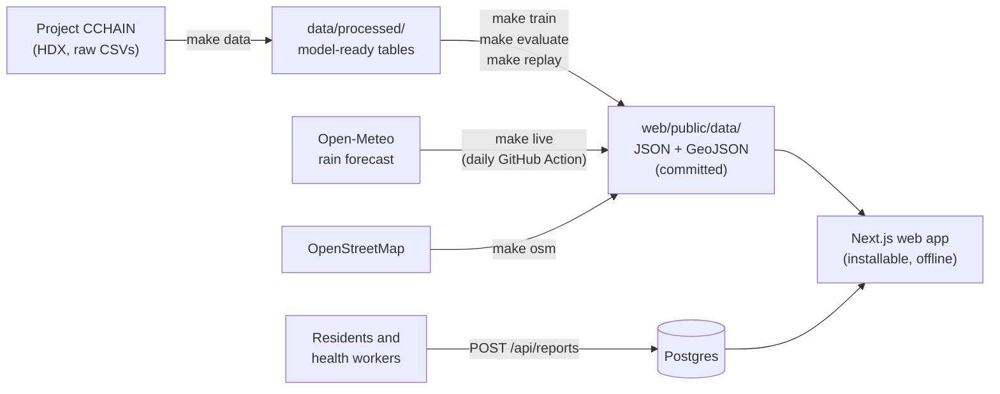

# Project LUNOP

**L**eptospirosis **U**psurge **N**owcasting & **O**utbreak **P**revention

LUNOP is a web-based predictive and prescriptive decision-support system for the Iloilo City Health Office response to leptospirosis after floods. 

It estimates the timing and size of case surges, highlights barangays with higher flood exposure, and turns those signals into practical response priorities. 

Community flood reports and offline support help health workers and residents contribute on the ground.

## The Problem

Health teams must make decisions before reported cases reveal an outbreak.

- Floodwater can expose people to *Leptospira*, the bacteria that cause leptospirosis.
- A Philippine study found the strongest association between heavy rainfall and leptospirosis admissions about **two weeks later**, with flooding helping explain that relationship (Matsushita et al., 2018).
- Historical records show Iloilo City carries a substantial share of reported leptospirosis cases, underscoring the need for timely prevention.
- Without an early picture of **when cases may rise and which communities may be most exposed**, health teams have less time to prepare and target their response.

## Our Solution

LUNOP gives the Iloilo City Health Office an early, practical view of the response after floods.

1. **Estimate the surge:** forecast the expected size and timing of leptospirosis cases after heavy rainfall.
2. **Identify priority areas:** rank barangays by estimated flood exposure, with community reports adding local context.
3. **Guide the response:** turn forecasts and exposure signals into time-bound priorities for prevention, case finding, and hospital readiness.
4. **Support field reporting:** let residents and health workers submit flood reports, including when connectivity is limited.

Together, these capabilities help teams decide **how many, where, and what to do** before cases rise.

## Who Benefits

### Iloilo City Health Office

- Earlier warning of a potential post-flood case surge.
- Barangay exposure rankings to help focus prevention and case-finding efforts.
- Clear response priorities for prophylaxis planning and hospital readiness.

### Barangay Health Workers and BDRRM Officers

- A simple way to report local flooding and wading exposure.
- Visibility into barangay priorities and recent community reports.
- Offline reporting support when connectivity is unavailable.

### City Engineering's Office and DRRMO

- A view of recurring flood spots identified from community reports.
- Local context to help prioritize drainage and other mitigation work.

### Residents and Hospitals

- Residents can contribute flood reports that add local context to the response.
- Hospitals can use surge timing and estimates to prepare staff and supplies.

## Core Features

- **Post-flood surge forecasts:** estimate weekly leptospirosis cases and likely peak timing.
- **Barangay exposure priorities:** map and rank areas using flood hazard, population, and recent reports.
- **Action recommendations:** present time-bound priorities for prevention, case finding, and hospital readiness.
- **Community flood reporting:** submit flood depth, duration, and wading reports from a phone.
- **Storm replay and validation:** explore past events and compare forecasts with observed cases.
- **Chronic flood spot tracking:** surface locations with repeated reports for follow-up by city teams.
- **Offline field access:** view saved information and queue reports when the device is offline.


## Architecture



- **`pipeline/`** (Python) does all modeling offline and writes static files to `web/public/data/`.
- **`web/`** (Next.js) reads those files and runs the decision rules (priority, doses, countdowns, recommendations) in the browser, so it works offline.
- The only live server parts are the daily forecast job and the flood-report API.

## Quick start

**Prerequisites:** [uv](https://docs.astral.sh/uv/) (installs Python 3.11), Node.js 20.9 or newer, and `make`. Postgres is optional (only for flood reports).

```bash
make setup   # install Python and Node dependencies
make web     # run the app at http://localhost:3000
```

The model outputs are committed in `web/public/data/`, so the app runs without downloading any data. To rebuild everything from raw data:

```bash
make all     # setup, data, train, evaluate, replay
make test    # pytest + vitest
```

**Flood reports (optional).** The report form and live reports need Postgres. For local development:

```bash
docker run --name lunop-db -e POSTGRES_DB=lunop -e POSTGRES_PASSWORD=<password> -p 5432:5432 -d postgres:16
psql "postgres://postgres:<password>@localhost:5432/lunop" -f web/db/schema.sql
```

Then create `web/.env.local` with `DATABASE_URL` (the connection string above) and `IP_SALT` (any random string, used to hash reporter IPs).

## Data

| Source | Used for |
|---|---|
| [Project CCHAIN](https://data.humdata.org/dataset/project-cchain) (HDX) | Leptospirosis cases (PIDSR), rain, flood hazard (NOAH), population (WorldPop), boundaries, hospital access |
| [Open-Meteo](https://open-meteo.com/) | Live rain forecast |
| [OpenStreetMap](https://www.openstreetmap.org/) | Health facility and waterway map layers |
| Community reports | Flood depth and wading, sent from the app |

`make data` downloads the CCHAIN tables into `data/raw/`, checks each file against `pipeline/raw.sha256` so every rebuild uses the same snapshot, and builds the processed tables. `data/` is gitignored. Column definitions: [docs/DATA.md](docs/DATA.md).

## Make targets

| Target | What it does | Outputs |
|---|---|---|
| `make setup` | Install dependencies (`uv sync`, `npm install`) | `pipeline/.venv`, `web/node_modules` |
| `make data` | Download, verify and build CCHAIN data | `data/raw/`, `data/processed/*.parquet`, `web/public/data/barangays.geojson` |
| `make osm` | Fetch OpenStreetMap layers (one-time) | `web/public/data/facilities.geojson`, `waterways.geojson` |
| `make train` | Compare rain sources, fit the models | `pipeline/models/rain_scale.json`, `model.json` |
| `make evaluate` | Back-test, event study, leave-one-event-out, Zamboanga check | `web/public/data/performance.json`, `pipeline/models/thresholds.json`, `pipeline/reports/backtest.md` |
| `make replay` | Build past-storm replays | `web/public/data/replay/*.json` |
| `make live` | Today's forecast from Open-Meteo (also runs daily in GitHub Actions) | `web/public/data/forecast.json` |
| `make web` | Run the app in development | http://localhost:3000 |
| `make test` | Run all tests | |
| `make all` | `setup`, `data`, `train`, `evaluate`, `replay` | |

## Repository layout

```
pjdsc-26/
├── pipeline/   Python: data, model, evaluation (uv project; lunop/ package, tests/, models/, reports/)
├── web/        Next.js app (app/ routes, components/, lib/ decision rules, public/data/ model outputs)
├── eda/        exploratory notebooks and HTML reports
├── docs/       PRD, TRD, FINDINGS, DATA, REFERENCES
├── data/       raw/, interim/, processed/, external/ (gitignored)
└── Makefile
```

## Documentation

- [PRD](docs/PRD.md): problem, users, features, future directions
- [TRD](docs/TRD.md): architecture, data, model, decision rules, offline design
- [FINDINGS](docs/FINDINGS.md): what the data shows, challenges and mitigation
- [DATA](docs/DATA.md): column definitions for every output
- [Back-test report](pipeline/reports/backtest.md): forecast accuracy against baselines
- [REFERENCES](docs/REFERENCES.md): all sources, APA 7

## Team

Team Random Seed 42, [PJDSC 2026](https://pjdsc26-website.vercel.app/):

- [@andrianllmm](https://github.com/andrianllmm)
- [@Romyr05](https://github.com/Romyr05)
- [@llaollao902](https://github.com/llaollao902)

## License

[MIT](LICENSE)
